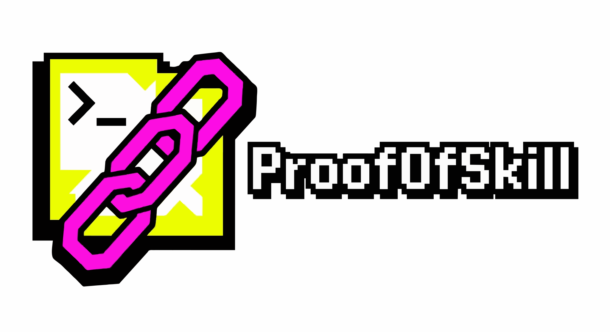

<div align="center">



**Demonstrate it. Get evaluated. Verify it onchain.**

<br />

> ### 🧬 **ProofOfSkill turns demonstrated technical ability into portable, verifiable onchain credentials.**

<br />

<a href="./LICENSE"></a>
<a href="./CONTRIBUTING.md"></a>


<br />
<br />

<a href="#-demo-path-for-judges"><kbd>&nbsp;▶ Demo Path&nbsp;</kbd></a>
<a href="#-architecture"><kbd>&nbsp;🧭 Architecture&nbsp;</kbd></a>
<a href="#-smart-contract"><kbd>&nbsp;⚓ Smart Contract&nbsp;</kbd></a>
<a href="#-quick-start"><kbd>&nbsp;⚡ Quick Start&nbsp;</kbd></a>

</div>

---

## 🚦 Build Status

> [!IMPORTANT]
> The sections below describe the intended architecture. This section tracks what is **actually built and verified right now**, and is updated as work lands.

**Verified on this machine** — the program compiles clean for the host target (`cargo check`), passes `cargo clippy -- -D warnings` and `cargo fmt --check`, and **28 `cargo test` assertions pass**, pinning account discriminators, serialized byte offsets, `INIT_SPACE` totals (73 / 57 / 115), instruction sighashes and all seven PDA derivations against vectors computed independently with `@solana/web3.js`. `vitest` unit tests are green for the challenge catalogue and evidence hashing.

**Blocked on this host** — `anchor build` / `anchor test` cannot run: anchor-cli 0.29 invokes the legacy `cargo-build-bpf`, and `cargo build-sbf` needs privileges to symlink platform-tools. So there is no `.so`, no IDL, no Devnet deployment and therefore **no real transaction signature** yet. Details: [docs/living-notes.md](./docs/living-notes.md) → Blockers.

### MVP checklist

- [x] Phase 0 — repository audit, `.gitignore`, toolchain and package versions resolved
- [x] Phase 1 — Anchor program source: `initialize_config`, `initialize_profile`, `issue_credential` (verified by host `cargo check` + `clippy`)
- [ ] Phase 1 — `anchor build` + `anchor test` — **BLOCKED** (host toolchain, see above)
- [x] Phase 2 — Next.js App Router + Tailwind v4 scaffold
- [x] Phase 2 — Typed challenge catalogue with weighted rubrics
- [x] Phase 2 — Canonical submission hashing and SHA-256 evidence hash
- [x] Phase 2 — Rubric-based AI evaluation service
- [ ] Phase 2 — HMAC attestation plus `/api/evaluate` and `/api/issue`
- [x] Phase 2 — Solana client layer (PDAs, codecs, transaction builder)
- [ ] Phase 2 — Wallet Adapter and Phantom connect
- [ ] Phase 3 — Landing page separating AI Evaluation from Onchain Verification
- [ ] Phase 3 — Challenge list and challenge workspace
- [ ] Phase 3 — Evaluation result screen
- [ ] Phase 3 — Transaction status component with mapped errors
- [ ] Phase 3 — Dashboard
- [ ] Phase 3 — Public `/verify/[credentialId]` page
- [ ] Phase 4 — Motion transitions and lazy-loaded 3D hero
- [ ] Phase 5 — `typecheck`, `lint`, `build` and program tests green
- [ ] Phase 6 — Devnet deploy and end-to-end demo transaction

---

## 🎯 The Problem

Résumés are claims. Certificates are screenshots. Neither shows that someone can actually do the work.

**ProofOfSkill** replaces the claim with a record:

```text
Challenge → Submission → AI Evaluation → Pass / Fail → Onchain Verification → Public Reputation
```

A developer completes a practical technical challenge, submits real evidence, receives a rubric-based evaluation, and, on a pass, gets a credential recorded on Solana that anyone can verify at a public URL.

---

## ⚖️ The Key Distinction

ProofOfSkill keeps two trust layers separate, in the code, in the UI, and in this document.

<table>
  <tr>
    <td width="50%" valign="top">
      <h3>🤖 AI Evaluation</h3>
      <p>An AI model scores the submission against a <b>fixed, weighted rubric</b>. The server recomputes the final score from per-criterion points; the model never decides pass or fail.</p>
      <p><b>This is an assessment, not a cryptographic proof.</b></p>
    </td>
    <td width="50%" valign="top">
      <h3>⛓️ Onchain Verification</h3>
      <p>Solana records that <b>wallet X completed challenge Y with score Z at time T</b>, along with a hash of the submitted evidence.</p>
      <p><b>The chain is the source of truth for credential state. It does not prove the code is correct.</b></p>
    </td>
  </tr>
</table>

---

## ✨ Core Features

<table>
  <tr>
    <td width="50%" valign="top">
      <h3>🧪 Curated Challenges</h3>
      <p>Five hands-on challenges across Solana, Anchor, Web3 frontend, and security. Each has a typed rubric, difficulty, category, and time estimate.</p>
    </td>
    <td width="50%" valign="top">
      <h3>🤖 Rubric-Based AI Evaluation</h3>
      <p>Weighted criteria, transparent per-criterion feedback, strengths and weaknesses, and strict validation of the model's JSON output.</p>
    </td>
  </tr>
  <tr>
    <td width="50%" valign="top">
      <h3>⛓️ Onchain Verification</h3>
      <p>Passing results are issued as credential accounts on Solana Devnet, co-authorized by a server-held issuer and signed by the user's wallet.</p>
    </td>
    <td width="50%" valign="top">
      <h3>🧬 PDA Architecture</h3>
      <p>Deterministic, collision-free accounts derived from the wallet and challenge. One credential per wallet per challenge, enforced by the program.</p>
    </td>
  </tr>
  <tr>
    <td width="50%" valign="top">
      <h3>🔐 Evidence Integrity</h3>
      <p>Submissions stay offchain. A SHA-256 hash of the canonicalized submission is committed onchain, proving the integrity of the evidence representation, not its quality.</p>
    </td>
    <td width="50%" valign="top">
      <h3>🌐 Public Verification Page</h3>
      <p>Anyone can open <kbd>/verify/[credentialId]</kbd> and read the credential straight from Solana, with a link to Solana Explorer.</p>
    </td>
  </tr>
  <tr>
    <td width="50%" valign="top">
      <h3>📊 Reputation Dashboard</h3>
      <p>Total credentials, average score, skill categories, recent credentials, and transaction links for a connected wallet.</p>
    </td>
    <td width="50%" valign="top">
      <h3>👛 Wallet-Native Flow</h3>
      <p>Phantom support through the Solana wallet stack, with explicit states: connecting, signing, confirming, success, and mapped, human-readable errors.</p>
    </td>
  </tr>
</table>

---

## 🧭 Architecture

```mermaid
flowchart LR
    U["👤 User"] --> S["📝 Submission"]
    S --> API["Next.js Route Handler"]
    API --> AI["🤖 AI Evaluation"]
    AI -->|"score + attestation"| ISS["🔑 Issuer Authorization"]
    ISS -->|"partially signed tx"| W["👛 Wallet Signs"]
    W --> P["⚓ Anchor Program"]
    P --> C["🏅 Onchain Credential"]
    C --> V["🌐 Public Verification"]
```



**Issuer model.** The AI never signs a transaction. After a passing evaluation, the server mints a short-lived HMAC attestation. `/api/issue` verifies it, builds the transaction, and co-signs with the issuer key. The Anchor program accepts `issue_credential` only when that registered issuer signs. The user pays fees and signs as well.

> [!NOTE]
> The issuer is **centralized and trusted** in this MVP. See [Limitations](#-limitations).

---

## ⚓ Smart Contract

Built with **Anchor (Rust)**.

| | |
|---|---|
| **Program** | `proof_of_skill` |
| **Network** | Solana Devnet |
| **Program ID** | `<PROGRAM_ID>` ← fill in after deployment |

### Accounts

| Account | PDA Seeds | Holds |
|---|---|---|
| `Config` | `["config"]` | admin, authorized issuer |
| `UserProfile` | `["profile", user]` | wallet, created_at, completed_count, reputation |
| `Credential` | `["credential", user, challenge_id]` | wallet, issuer, challenge_id, score, evidence_hash, issued_at |

### Instructions

| Instruction | Purpose |
|---|---|
| `initialize_config` | Registers the authorized issuer (upgrade authority only) |
| `initialize_profile` | Creates the user's profile PDA |
| `issue_credential` | Creates a credential PDA; requires user and issuer signatures, a valid challenge ID, and a passing score |

### Data Model

<table>
  <tr>
    <td width="50%" valign="top">
      <b>⛓️ Onchain</b>
      <ul>
        <li>Profile and Credential accounts</li>
        <li>Score, timestamp, issuer</li>
        <li>Evidence hash (SHA-256)</li>
      </ul>
    </td>
    <td width="50%" valign="top">
      <b>☁️ Offchain</b>
      <ul>
        <li>Full submission and repository URL</li>
        <li>AI feedback and per-criterion detail</li>
        <li>Challenge catalogue and UI metadata</li>
      </ul>
    </td>
  </tr>
</table>

---

## 🛠️ Tech Stack

<div align="center">

**Frontend**


<br />

**Blockchain**


<br />

**Evaluator**


</div>

---

## 🏁 Demo Path (for Judges)

1. Open the app and read the landing page.
2. Go to <kbd>/challenges</kbd> and open **Solana PDA Fundamentals**.
3. Write an explanation, add a code snippet, and optionally a GitHub URL, then submit.
4. Review the **AI Evaluation**: score, per-criterion rubric results, strengths, weaknesses.
5. On a **PASS**, connect **Phantom** (set to Devnet, with a little Devnet SOL).
6. Click **Issue Onchain Credential** and sign the transaction.
7. Wait for confirmation, then open <kbd>/dashboard</kbd> to see the credential.
8. Open <kbd>/verify/[credentialId]</kbd>, the public page, and follow the **Solana Explorer** link.

---

## ⚡ Quick Start

<details>
<summary><b>📦 Prerequisites</b></summary>

<br />

- Node.js and `pnpm`
- Rust, Solana CLI, and Anchor CLI (see the [Solana installation guide](https://solana.com/docs/intro/installation))
- Phantom wallet set to Devnet

</details>

<details>
<summary><b>🚀 Install and run the frontend</b></summary>

<br />

```bash
git clone <your-repo-url>
cd proofofskill
pnpm install
cp .env.example .env.local   # then fill in the values below
pnpm dev
```

</details>

<details>
<summary><b>🔐 Environment variables</b></summary>

<br />

| Variable | Scope | Purpose |
|---|---|---|
| `NEXT_PUBLIC_SOLANA_NETWORK` | public | `devnet` |
| `NEXT_PUBLIC_SOLANA_RPC_URL` | public | RPC endpoint |
| `NEXT_PUBLIC_PROGRAM_ID` | public | Deployed program ID |
| `AI_API_KEY` | **server** | Evaluator API key |
| `AI_BASE_URL` | **server** | OpenAI-compatible endpoint |
| `AI_MODEL` | **server** | Model identifier |
| `ISSUER_PRIVATE_KEY` | **server** | Issuer keypair (JSON byte array) |
| `ATTESTATION_SECRET` | **server** | HMAC secret for attestations |

> [!WARNING]
> Never commit `.env.local`, keypairs, or seed phrases. Server-only values must never use the `NEXT_PUBLIC_` prefix.

</details>

<details>
<summary><b>⚓ Build and test the program</b></summary>

<br />

```bash
anchor build
anchor test
```

</details>

<details>
<summary><b>🌐 Deploy to Devnet</b></summary>

<br />

```bash
solana config set --url devnet
anchor deploy --provider.cluster devnet
```

Then initialize the `Config` account with your issuer public key and set `NEXT_PUBLIC_PROGRAM_ID`.

</details>

<details>
<summary><b>🗂️ Project layout</b></summary>

<br />

| Path | Contents |
|---|---|
| <kbd>programs/proof_of_skill/</kbd> | Anchor program |
| <kbd>tests/</kbd> | Program tests |
| <kbd>app/</kbd> | Next.js routes and API handlers |
| <kbd>components/</kbd> | UI components |
| <kbd>lib/solana/</kbd> | PDAs, program client, transaction builder |
| <kbd>lib/evaluation/</kbd> | Evaluator, rubric scoring, schema validation |
| <kbd>lib/hashing/</kbd> | Canonical JSON and evidence hash |

</details>

---

## ⚠️ Limitations

- **AI evaluation is not cryptographic proof of skill.** It is a rubric-based assessment and can be wrong.
- **The issuer is centralized and trusted** in the MVP. The program trusts one registered issuer key.
- Attestation tokens are not bound to a wallet at mint time; per-wallet, per-challenge uniqueness is enforced by the Credential PDA.
- The challenge catalogue is small and hardcoded (five challenges).
- Devnet only.
- The repository URL is stored and hashed but is not fetched or analyzed.

---

## 🤝 Contributing

PRs are welcome. Open an issue first for anything larger than a bug fix.

## 📄 License

Released under the MIT License. See [LICENSE](./LICENSE).

---

<div align="center">

<sub><b>ProofOfSkill</b> · Skill → Evaluation → Verification → Reputation</sub>

</div>